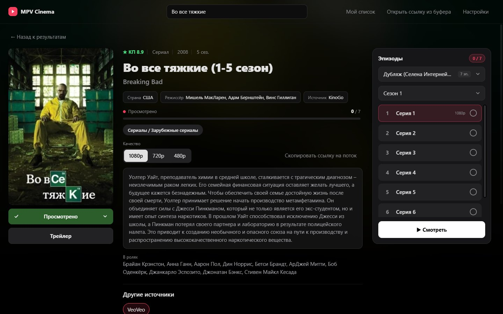
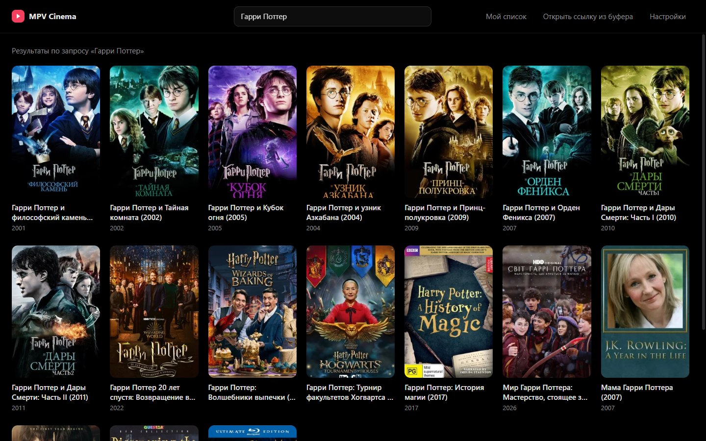
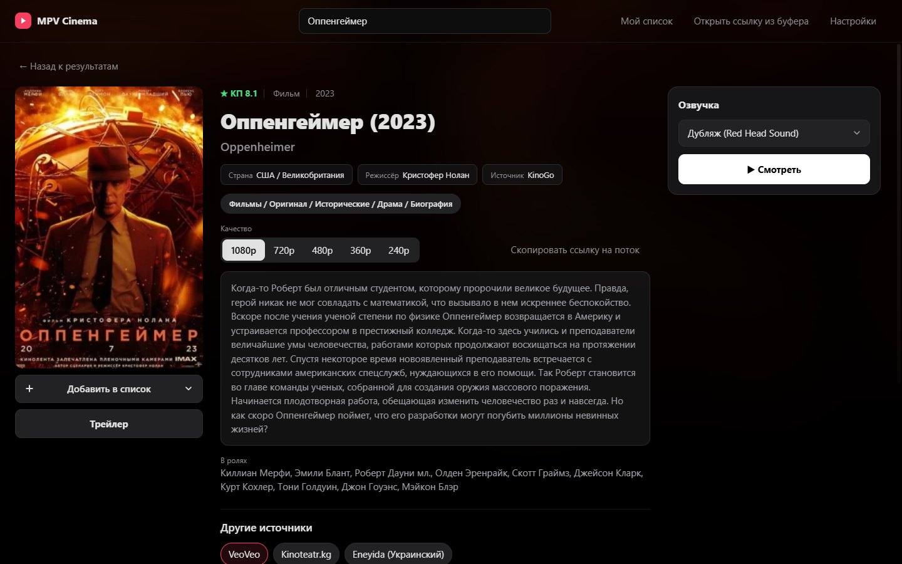
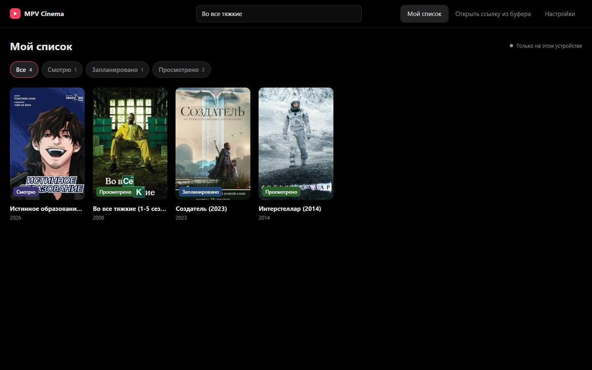
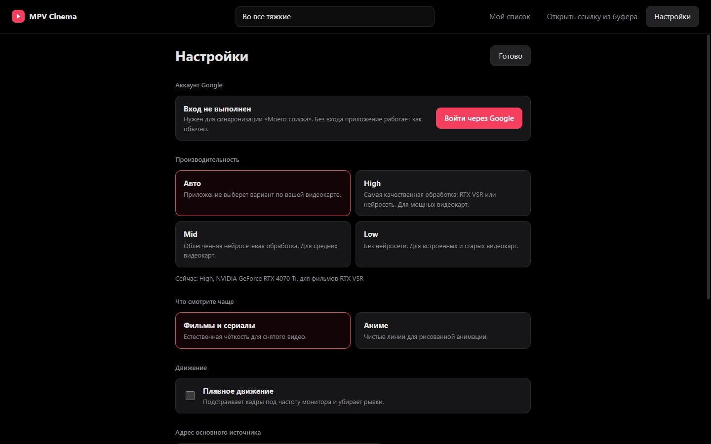

<div align="center">


# MPV Cinema

**Домашний кинотеатр на [mpv](https://mpv.io/).** Найдите фильм, выберите озвучку и смотрите в настоящем 1080p, с апскейлом под вашу видеокарту и плавным движением.


[**Скачать**](../../releases/latest) · [Возможности](#возможности) · [Установка](#установка) · [Разработка](#разработка)



</div>

## Возможности

<table>
<tr>
<td width="50%" valign="top">

### 🔎 Поиск и каталог
Сетка постеров, понятные названия и годы. Если на основном источнике ничего не нашлось, приложение само ищет на запасном.

</td>
<td width="50%" valign="top">

### 🎬 Страница тайтла
Рейтинг, сведения, жанры, трейлер и описание. Озвучка, качество и кнопка «Смотреть» собраны в одной панели, у сериалов там же сезоны и серии.

</td>
</tr>
<tr>
<td valign="top">



</td>
<td valign="top">



</td>
</tr>
<tr>
<td width="50%" valign="top">

### 📋 Мой список
Статусы «Смотрю», «Запланировано» и «Просмотрено», отметки просмотренных серий. Начатый просмотр отмечается сам, досмотренная серия тоже.

</td>
<td width="50%" valign="top">

### ⚙️ Настройки понятным языком
Пресет под видеокарту (Авто, High, Mid, Low), «Фильмы» или «Аниме», плавное движение. Без единого термина mpv.

</td>
</tr>
<tr>
<td valign="top">



</td>
<td valign="top">



</td>
</tr>
</table>

### И ещё

- **☁️ Синхронизация через Google.** После входа «Мой список» одинаков на всех устройствах. Он хранится в скрытой папке приложения в вашем Google Drive, другие файлы приложению недоступны. Без сети изменения копятся и уходят позже.
- **🖼️ Апскейл под железо.** На GeForce RTX с подходящим драйвером для фильмов включается RTX VSR, иначе нейросеть FSRCNNX; для аниме — Anime4K. Профиль «Авто» выбирается по видеокарте.
- **🎞️ Плавное движение.** Интерполяция кадров под частоту монитора, без рывков на 24 кадрах.
- **🎛️ Плеер на русском.** Панель [uosc](https://github.com/tomasklaen/uosc) поверх видео: перемотка, дорожки и субтитры мышью, меню «Качество картинки» с реальным разрешением и переключением апскейла без перезапуска.
- **🌐 Дополнительные источники.** По желанию включается [Lampac NextGen](https://github.com/lampac-nextgen/lampac): он работает только на вашем компьютере и входит в установщик Windows как отдельная программа.
- **🛟 Надёжность.** Зеркала источников переключаются сами, при сбое CDN приложение берёт другой узел.
- **🔗 Запуск по ссылке.** Из буфера обмена или аргументом командной строки.

> Подписи качества у основного источника соответствуют реальной ширине кадра, а настоящее разрешение показывает меню «Качество картинки» в плеере. У запасного источника метки бывают завышены: `1080p` там часто означает 1280×720.

## Установка

1. Установите **mpv**: `winget install mpv` (Windows) или `brew install mpv` (macOS).
2. Установите **Google Chrome**: он нужен для запасного способа загрузки.
3. Скачайте установщик со страницы [**Releases**](../../releases/latest) и запустите. Установщик не подписан, поэтому Windows SmartScreen покажет предупреждение: «Подробнее» → «Выполнить в любом случае».

Шейдеры апскейла скачиваются сами при первом запуске.

### Вход через Google

В релизах вход работает сразу. Google покажет предупреждение о непроверенном приложении: нажмите «Дополнительно» → «Перейти на страницу MPV Cinema». Приложению нужны только имя и почта для отображения в настройках и своя скрытая папка в Drive. [Политика конфиденциальности](https://gist.github.com/Shura4eburek/f580be86b8fc373b893739f8ee86fe25#file-privacy-policy-md).

## Целевые машины

| Машина | GPU | Экран | Профиль |
|--------|-----|-------|---------|
| Десктоп (Windows) | RTX 4070 Ti | 2K (1440p) | RTX VSR или FSRCNNX x2_16 / Anime4K HQ / интерполяция |
| MacBook Air | Apple M1 | Retina | облегчённый: FSRCNNX x2_8 / ewa_lanczossharp |
| Универсальный | Любой | Любой | базовый: gpu-hq |

## Разработка

Нужны Python 3.10+, Node.js 22+, Rust и [системные зависимости Tauri](https://v2.tauri.app/start/prerequisites/).

```bash
python -m pip install -e ".[dev]"
cd app
npm install
npx tauri dev
```

Если проект лежит в OneDrive, задайте `CARGO_TARGET_DIR` вне синхронизируемой папки.

Устройство приложения: Svelte → команда Tauri → Rust → JSON Lines → Python-backend, который ищет фильмы, получает потоки и запускает mpv. Подробно архитектура, протокол и настройка шейдеров описаны в [**AI_DEVELOPER_GUIDE.md**](AI_DEVELOPER_GUIDE.md).

### Тесты

```bash
python -m pytest
cd app
npm test
npm run check
cargo test --manifest-path src-tauri/Cargo.toml
```

### Сборка установщика Windows

```powershell
python -m pip install -e ".[build]"
pwsh -ExecutionPolicy Bypass -File build\build_windows.ps1
```

Установщик появится в `%LOCALAPPDATA%\mpv-cinema-target\release\bundle\nsis`. Для macOS есть `build/build_macos.sh`, на Mac он ещё не проверялся.

<details>
<summary><b>Вход через Google в собственной сборке</b></summary>

В репозитории нет идентификатора Google-клиента, поэтому в своей сборке кнопка входа недоступна. Чтобы включить вход:

1. [Google Cloud Console](https://console.cloud.google.com/) → «APIs & Services»: включите Google Drive API.
2. «OAuth consent screen»: тип External, режим Testing, добавьте свой аккаунт в тестировщики; scopes `openid`, `email`, `profile`, `.../auth/drive.appdata`.
3. «Credentials» → «Create OAuth client ID» → «Desktop app».
4. Сохраните скачанный JSON как `packaging/google_client.json` (в git не попадает, в сборку входит сам) или задайте `MPV_CINEMA_GOOGLE_CLIENT_ID` и `MPV_CINEMA_GOOGLE_CLIENT_SECRET` для `npx tauri dev`.

Пока приложение в режиме Testing, войти могут только аккаунты из списка тестировщиков.

</details>

<details>
<summary><b>Запуск из консоли (CLI)</b></summary>

```bash
# Поиск фильма и автозапуск в лучшем качестве:
python -m mpv_launcher.cli --search "Тенет"

# Ссылка аргументом (авто-профиль под железо, кино по умолчанию):
mpvplay "https://cdn/.../hls-v1-a4.m3u8"

# Запуск по ссылке из буфера обмена:
mpvplay

# Аниме-пресет с интерполяцией кадров:
mpvplay "https://..." --anime --profile desktop-4070ti --interpolation

# Предпросмотр собранной команды mpv без запуска:
mpvplay --search "Довод" --dry-run
```

</details>

## Отказ от ответственности

MPV Cinema не размещает и не распространяет видео. Приложение открывает страницы общедоступных сайтов так же, как браузер, и передаёт найденный поток в mpv на вашем компьютере. За соблюдение законов вашей страны и правил сайтов отвечает пользователь.

## Лицензии

Код MPV Cinema распространяется по лицензии [MIT](LICENSE). Интерфейс плеера использует [uosc](https://github.com/tomasklaen/uosc) (LGPL-2.1), см. `mpv-profiles/player/LICENSE-uosc.txt`. Lampac NextGen распространяется под AGPL-3.0 как отдельная неизменённая программа.
